# 🛡️ SOC Home Lab — Wazuh SIEM with Active Directory Attack & Detection

A self-built, fully virtualized Security Operations Center (SOC) lab used to simulate real-world attacks against a Windows Active Directory environment and detect them with a Wazuh SIEM. Built from scratch on a single workstation to practice blue-team / Tier 1 SOC analyst skills: log collection, threat hunting, detection engineering, and incident analysis.

> **Why I built this:** To go beyond certifications (CompTIA A+, Network+, Security+, ITIL 4) and get hands-on with the actual day-to-day work of a SOC analyst — collecting telemetry, hunting through alerts, and engineering detections for attacker behavior.

---

## 📐 Architecture

All machines run as KVM/QEMU virtual machines on an isolated NAT network (`labnet`, `10.10.10.0/24`). Nothing in the lab touches the host network or the internet-facing LAN beyond package updates.

```
                         ┌─────────────────────────────┐
                         │      Host: Bazzite-DX        │
                         │   Ryzen 7 3700X / 32GB RAM   │
                         │     KVM / QEMU / libvirt     │
                         └─────────────┬───────────────┘
                                       │  labnet 10.10.10.0/24 (NAT)
         ┌───────────────┬─────────────┼──────────────────┬───────────────┐
         │               │             │                  │               │
   ┌───────────┐   ┌───────────┐  ┌───────────┐     ┌───────────┐
   │   DC01    │   │  WIN11-01 │  │   Wazuh   │     │   Kali    │
   │ Win Srv   │   │  Win 11   │  │  SIEM     │     │  Attacker │
   │  2025     │   │ Enterprise│  │ Ubuntu    │     │           │
   │ AD / DNS  │   │ Endpoint  │  │  24.04    │     │           │
   │.10.10.10.5│   │.10.10.10.20│ │.10.10.10.10│    │.10.10.10.50│
   └───────────┘   └───────────┘  └───────────┘     └───────────┘
```

**Host & Hypervisor**

| Component | Detail |
|---|---|
| Host OS | Bazzite-DX (Fedora Atomic, immutable) |
| CPU / RAM | AMD Ryzen 7 3700X (8c/16t) / 32 GB |
| Virtualization | KVM / QEMU via `virt-manager` (libvirt) |
| Lab network | `labnet` — `10.10.10.0/24`, NAT, isolated |

**Virtual Machines**

| Host | Role | OS | IP |
|---|---|---|---|
| **DC01** | Domain Controller / DNS (`lab.local`) | Windows Server 2025 | `10.10.10.5` |
| **WIN11-01** | Domain-joined endpoint (victim) | Windows 11 Enterprise | `10.10.10.20` |
| **Wazuh** | SIEM — manager, indexer, dashboard | Ubuntu Server 24.04 | `10.10.10.10` |
| **Kali** | Attacker | Kali Linux | `10.10.10.50` |

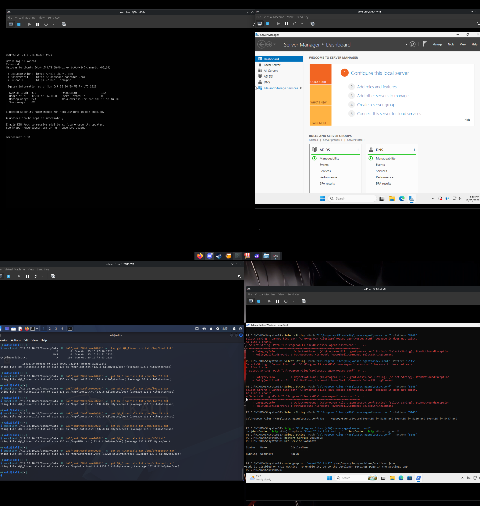
*All four VMs running under KVM/QEMU — Wazuh, DC01 (Server Manager showing the AD DS + DNS roles), Windows 11, and Kali.*

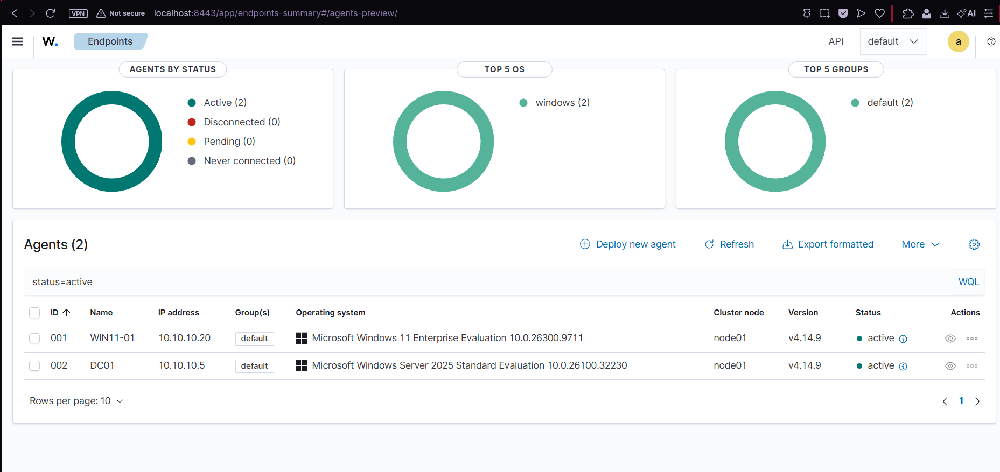
*Both Windows endpoints enrolled and actively reporting to the Wazuh manager.*

---

## 🧰 Tech Stack

- **SIEM:** Wazuh 4.14 (all-in-one: manager + indexer + dashboard)
- **Endpoint telemetry:** Wazuh agent + Sysmon (SwiftOnSecurity config)
- **Directory services:** Active Directory Domain Services (`lab.local`), DNS, Group Policy
- **Attacker tooling:** Nmap, CrackMapExec, smbclient
- **Detection:** Windows Security event logs, Sysmon, custom Wazuh rules, MITRE ATT&CK mapping

---

## 🏢 Active Directory Environment

A Windows Server 2025 domain controller (`lab.local`) with an organizational unit of standard domain users, plus a privileged `itadmin` account — realistic targets for credential-based attacks. The Windows 11 endpoint is domain-joined like a real corporate workstation.

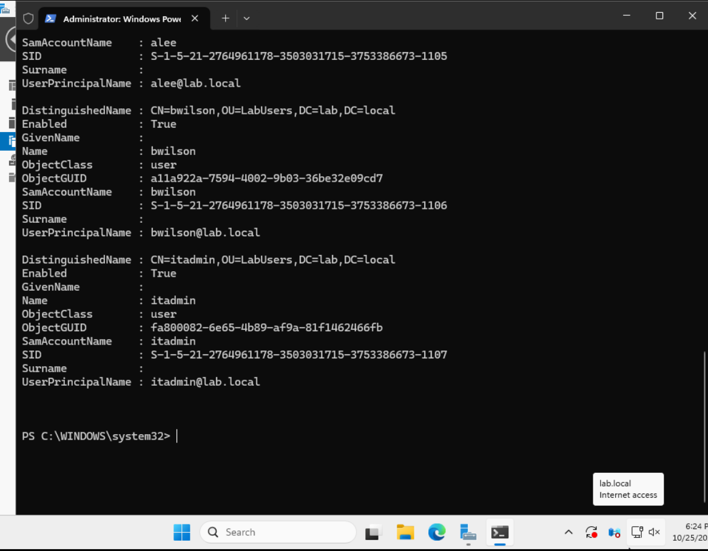
*Domain user accounts in the `lab.local` directory.*

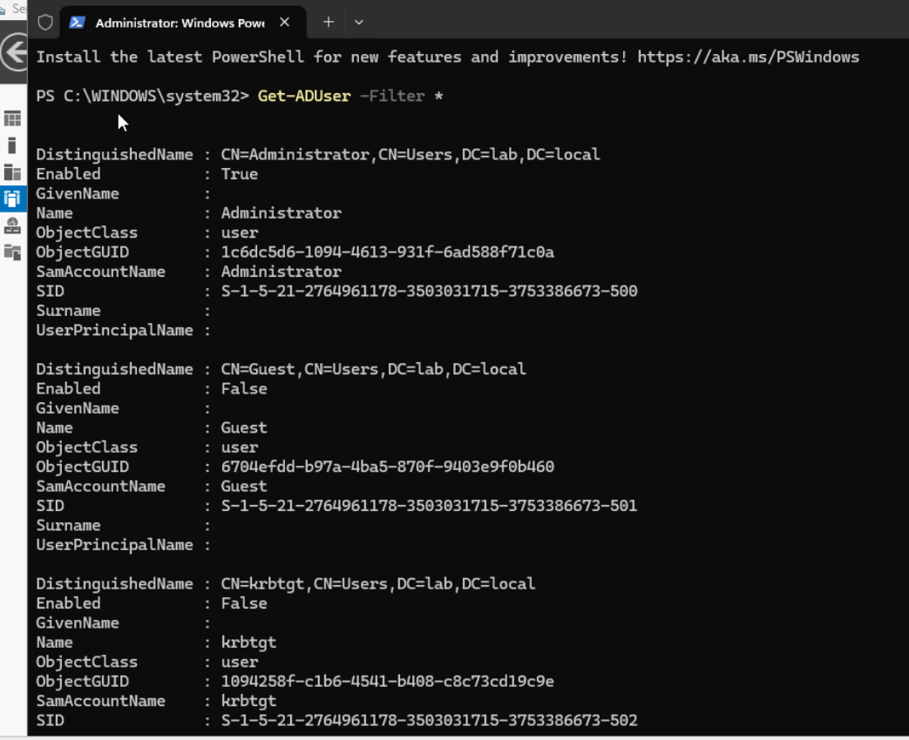
*The Windows 11 endpoint authenticated as a domain user (`lab\jsmith`).*

---

## ⚔️ Attack Scenarios & Detections

Each scenario was executed from the Kali attacker box and then investigated from the Wazuh dashboard — the full offensive → defensive loop.

### 1. Reconnaissance — Network & Service Discovery
**Technique:** `T1046` – Network Service Discovery
```bash
nmap -sn 10.10.10.0/24          # host discovery
nmap -sV -O 10.10.10.5          # service/version + OS fingerprint
nmap -A 10.10.10.5              # aggressive scan
```
Identified the domain controller by its service fingerprint — Kerberos (88), LDAP (389/636), Global Catalog (3268), DNS (53), SMB (445) — and confirmed the domain `lab.local`.

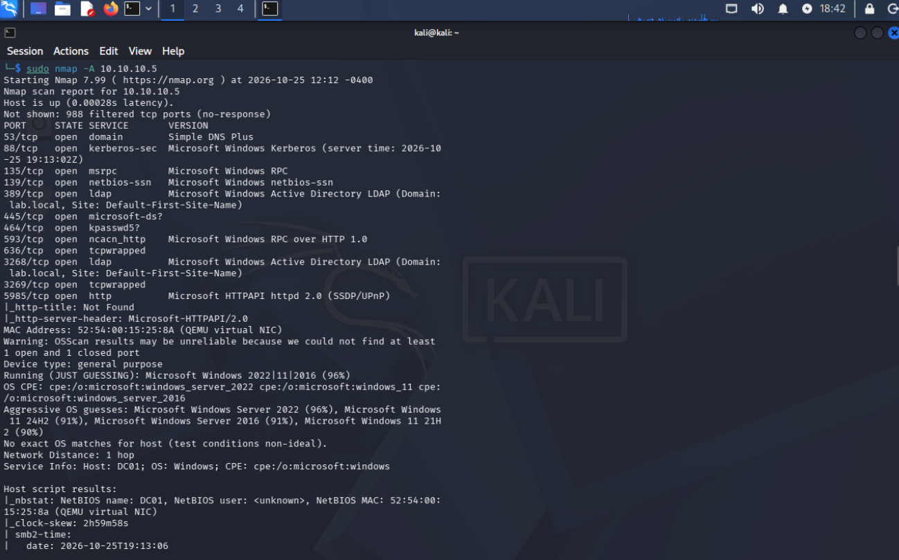
*Aggressive Nmap scan fingerprinting DC01 as a domain controller.*

> **Blue-team lesson:** Host-based agents (Wazuh/Sysmon) are weak at detecting port scans, because scan traffic is inbound and filtered as noise. Catching scans reliably requires a **network IDS** (e.g., Suricata/Snort). Documented as a planned improvement.

### 2. Credential Access — Password Brute Force
**Technique:** `T1110` – Brute Force
```bash
crackmapexec smb 10.10.10.5 -u jsmith -p wrongpass_list.txt
```
Generated a burst of failed domain logons.

**Detection:** Windows **Event ID 4625** (failed logon), surfaced in Wazuh with the attacker source IP (`10.10.10.50`), target account (`jsmith`), and failure reason. Repeated failures correlated into a higher-severity authentication-failure alert.

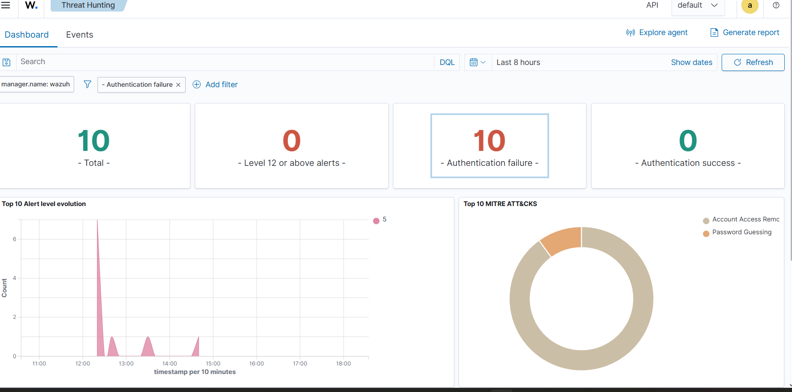
*Clustered authentication failures in the Wazuh Threat Hunting dashboard, mapped to MITRE ATT&CK.*

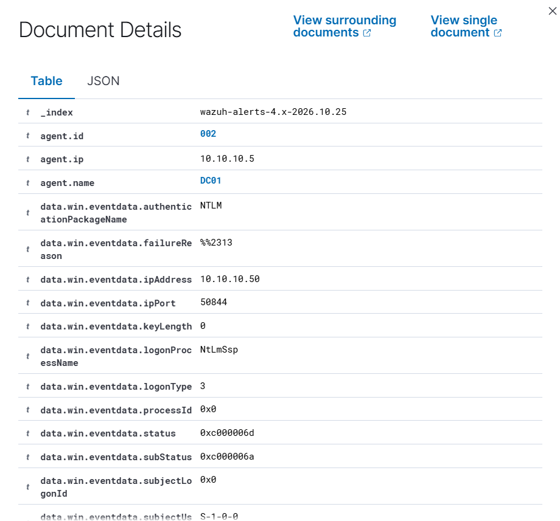
*Event 4625 detail — source IP `10.10.10.50`, target `jsmith`, logon type 3, bad-password substatus `0xC000006A`. This is the evidence an analyst puts in a ticket.*

### 3. Initial Access — Valid Credentials
**Technique:** `T1078` – Valid Accounts
```bash
crackmapexec smb 10.10.10.5 -u jsmith -p 'Welcome2026!'   # [+] success
```
**Detection:** Windows **Event ID 4624** (successful logon), logon type 3 (network), from the attacker IP — the pivot from "attempted" to "compromised."

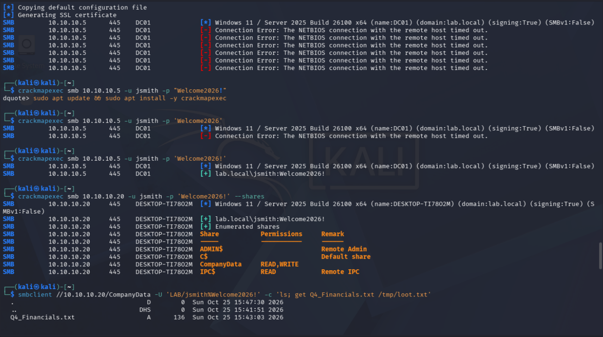
*Valid credential confirmed (`[+]`) and a misconfigured, world-readable SMB share (`CompanyData`, READ/WRITE) discovered.*

### 4. Collection & Exfiltration — Data from a Network Share
**Techniques:** `T1021.002` – SMB/Windows Admin Shares, `T1039` – Data from Network Shared Drive
```bash
smbclient //10.10.10.20/CompanyData -U 'LAB/jsmith%Welcome2026!' \
  -c 'get Q4_Financials.txt /tmp/loot.txt'
```
A "confidential" file was exfiltrated from the open share using only valid credentials — no exploit required, which mirrors how most real breaches occur.

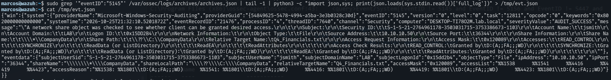
*Sensitive file pulled from the share to the attacker box, with contents confirmed.*

**Detection pipeline (detection engineering):**
- Enabled Windows **object-access auditing** (`auditpol` — Detailed File Share).
- **Tuned the Wazuh agent** to forward **Event ID 5145**, which the default agent config explicitly filters out as noise.
- Verified the SIEM captures the file-access event with full attribution — user, source IP, and filename.

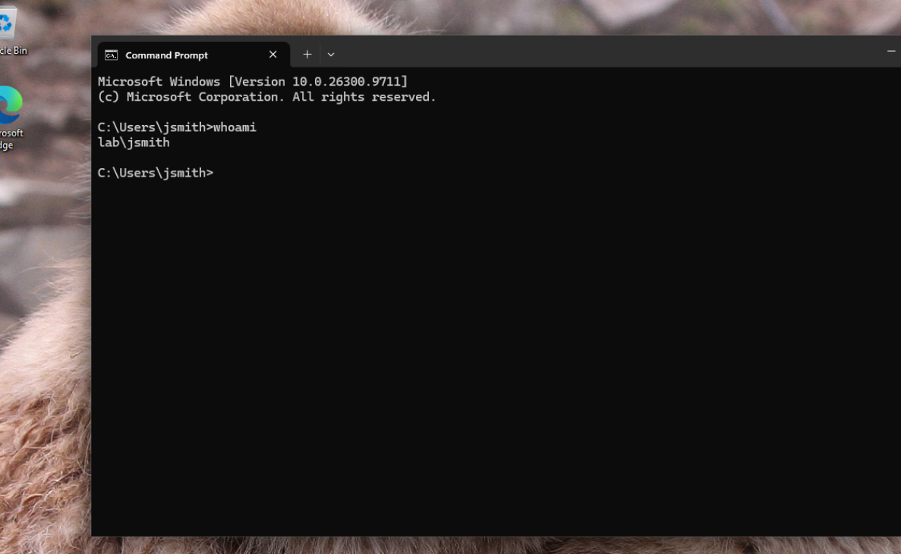
*The SMB file-access event (5145) captured by the SIEM: `jsmith` from `10.10.10.50` reading `Q4_Financials.txt`.*

- Authored a custom Wazuh rule mapping this behavior to **MITRE T1039**:

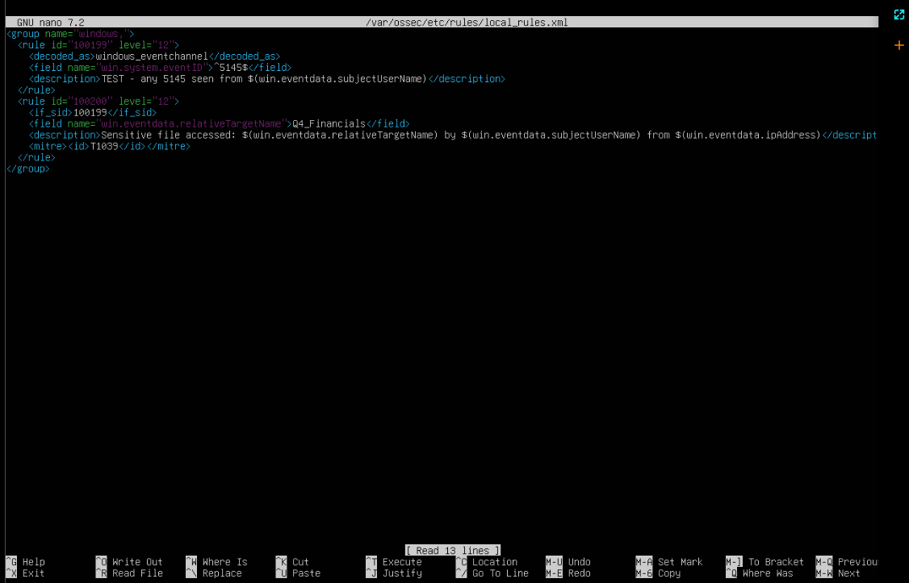
*Custom detection rule (`local_rules.xml`) for sensitive-file access over SMB, mapped to MITRE T1039.*

---

## 🗺️ MITRE ATT&CK Coverage

| Tactic | Technique | ID | Telemetry |
|---|---|---|---|
| Discovery | Network Service Discovery | T1046 | (network IDS — planned) |
| Credential Access | Brute Force | T1110 | Win EventID 4625 |
| Initial Access | Valid Accounts | T1078 | Win EventID 4624 |
| Lateral Movement | SMB / Admin Shares | T1021.002 | Win EventID 5140/5145 |
| Collection | Data from Network Shared Drive | T1039 | Win EventID 5145 (custom rule) |

---

## 🔧 Challenges & Troubleshooting (the real work)

The value of this lab was less in the "happy path" and more in diagnosing and fixing what broke:

- **Virtual TPM failure (`swtpm_setup` exit 1):** Windows 11's required vTPM wouldn't initialize on the immutable host. Traced it through the swtpm log to a missing `/var/lib/swtpm-localca` directory with the wrong ownership; fixed ownership (`tss:tss`) and SELinux context.
- **SELinux / libvirt storage permissions:** VMs on a secondary SSD failed with "permission denied." Resolved by applying the correct SELinux type (`virt_image_t`) to the VM image directory.
- **Ubuntu LVM under-provisioning:** The installer allocated only ~half the virtual disk by default; resized the logical volume so the SIEM had adequate storage.
- **Wazuh agent config corruption:** A config edit saved with the wrong text encoding broke the agent (`Error reading XML file`). Learned to force ASCII encoding on Windows config edits.
- **Agent-side event filtering:** The default Wazuh Windows agent **explicitly excludes Event ID 5145** via an event-channel query filter. Identified this as why file-access events never reached the manager, and tuned the agent to forward them — a real detection-engineering task.

### 🚧 Known Issue / In Progress
Event 5145 telemetry is **successfully collected and searchable in the SIEM with full attribution** (user, source IP, filename), confirmed via the manager's archive logs and `wazuh-logtest`. A custom alert rule (`rules/local_rules.xml`) was authored to raise a high-severity alert on sensitive-file access; the collection and detection logic are in place, with dashboard alert rendering (rule chaining for Security-channel events) the remaining item being debugged.

---

## 📈 Skills Demonstrated

- SIEM deployment and administration (Wazuh)
- Endpoint detection & response telemetry (Sysmon, Wazuh agent)
- Active Directory administration (DC promotion, OUs, users, domain join, GPO)
- Log analysis & threat hunting (Windows Security events, Sysmon)
- Detection engineering (audit policy, agent tuning, custom rules, MITRE mapping)
- Offensive tooling for validation (Nmap, CrackMapExec, SMB)
- Linux & Windows administration, virtualization, networking, SSH tunneling

---

## 🚀 Planned Improvements

- [ ] Add **Suricata** (network IDS) to detect the recon/port-scan phase
- [ ] Resolve custom 5145 alert rendering in the dashboard
- [ ] Add **Atomic Red Team** for broader technique coverage
- [ ] Build detections for Kerberoasting and other AD attacks
- [ ] Integrate **VirusTotal** for malware-detection enrichment

---

## 📁 Repository Structure

```
soc-home-lab/
├── README.md
├── rules/
│   └── local_rules.xml         # custom Wazuh detection rule(s)
├── configs/
│   └── sysmonconfig.xml         # Sysmon config reference
└── screenshots/                 # lab evidence (11 images)
```

---

*Built and documented by Marcos Fagundes — CompTIA A+ / Network+ / Security+ / ITIL 4 — B.S. Cybersecurity (in progress), WGU.*
